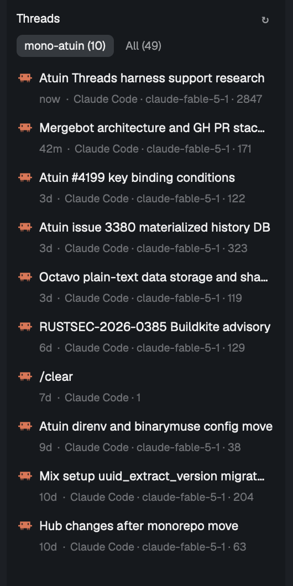

# Atuin Threads

A list of the coding-agent sessions Atuin has captured as threads, newest first, for the repo
of the space you are looking at, or for every space. Each row is one session: the agent's
icon, its title, how long ago it was last active, the agent, the model and the message count.
Click a row and a new tab opens in that space, in the folder the session worked in, with the
session resumed in its own agent; Atuin writes the transcript out from sync first when this
machine doesn't have it. Shift-click forks it instead. It opens as a popup over the window
(`cmd-shift-t`), and fits a side panel of a cloned layout just as well.

## What you see

One column on the `chrome` background, base type 12.5px. Top to bottom:

- **Header**, 10px side padding, 10px above, 6px below. The word "Threads" at 12px,
  semibold, `foreground`, on the left. On the right a 20px square button, `muted`, with
  the glyph ↻; while a load runs it shows `mods/workspace-chrome/spinner.svg` at 12px in
  the `working` color, spinning once every 900 ms.
- **Scope chips**, a row with 4px gaps, 6px under the header: two pills 22px tall, 8px side
  padding, radius 6, 11.5px type. The first says the repo's folder name and the count of
  its threads, as `mono-atuin (10)`; it says `This space` when the space is unknown. The
  second says `All (49)` with every thread's count. The chosen one is `foreground` on the
  `raised` background; the other is `muted` with no background. Both get the `hover`
  background under the pointer.
- **The list**, scrolling, 4px side padding, 6px below. Each row is two lines on a radius 7
  card, 8px side and 5px vertical padding, `hover` under the pointer:
  - Line one: the agent's icon at 14px (the app's `icons/claude.svg` and `icons/codex.svg`
    in full color; `icons/copilot.svg`, `icons/opencode.svg` and `icons/pi.svg` tinted
    `muted`, pi's also standing for omp), a 7px gap, then the title in `foreground`,
    truncated to the width. A session without a title shows its first prompt; without
    that, `(untitled)`.
  - Line two, indented 21px to line up with the title, 11px `dim`: the age (`now`, `12m`,
    `3h`, `6d`), a `·`, then `Claude Code · claude-fable-5-1 · 2847` (agent name, model
    when known, message count), truncated. In the All scope a further `·` and the folder's
    name in `muted`.
- In place of the list: `Loading…` before the first load; `No threads in mono-atuin yet.`
  or `No threads captured yet.` when the scope is empty; and when atuin fails,
  `atuin: <its first line>` in the `blocked` color. Each at 12px with 12px side and 10px
  vertical padding.

As a popup it is 400×560 px, centered, dimming the window.

## How it behaves

- It doesn't show agent statuses: a thread is a stored session, not a running agent. The
  only motion is the header's spinner while atuin runs.
- A click on a row runs `tab.new` in the shown space: name = the first 28 characters of the
  title (none when the session has no title), folder = the session's folder when it exists
  here (checked with `test -d`; otherwise atuin picks), argv = `atuin threads resume <id>`.
  Shift-click adds `--fork`. The new tab's program becomes the session's agent once atuin
  hands over to it (Herdr follows the foreground process), so the tab reads as Claude Code,
  Codex, Copilot, opencode, pi or omp with the session's title.
- The scope chips switch the list; the choice is not saved.
- The list reloads every 30 s and on ↻. It re-renders by itself when the shown space
  changes, which switches the repo filter at once.
- The repo filter: the shown space's place is its first terminal's live folder (as the
  `spaces` sidebar sees it), else the space's folder; `git rev-parse --show-toplevel` there
  gives the root, looked up once per folder; threads whose folder is that root or inside
  it are the space's. Outside a repo, the folder itself is used.
- Hidden: sessions that are another session's subagent (rows with `parent_atuin_id`), since
  resuming one resumes its parent.

## Built from

- `mods/atuin-threads/main.js`: one `View`, default export. `mod.json`:
  `{ "place": "none", "title": "Threads", "overlay": { "width": 400, "height": 560 } }`,
  so `mod.open {name: "atuin-threads"}` shows it as a popup and no layout docks it.
  `threads.svg`: a 24×24 speech-bubble outline with two lines in it, stroked
  `currentColor`, for a layout's panel button.
- `keys.json`: `"cmd-shift-t": "mod.open:atuin-threads"` in `global`.
- `herdr` functions: `exec` (atuin, git, test), `spaces()`, `panes()`, `run` (`tab.new`),
  `theme()`, `appHome()`, `readTextFile` (the override below). `gpui-kit`: `View`, `div`,
  `svg`, `image`; `gpui-base`: `v_flex`, `h_flex`.
- Programs run: `atuin threads search "" --limit 80 --style json` (the 80 newest threads
  matching nothing, as a JSON list of `{session: {...}}`; each `session` has `atuin_id`,
  `harness`, `title`, `preview`, `cwd`, `model`, `message_count`, `updated_at`,
  `parent_atuin_id`), `atuin threads resume <atuin_id> [--fork]` in the new tab, `git -C
  <dir> rev-parse --show-toplevel`, `test -d <dir>`.
- The atuin binary is `atuin` from the user's PATH, unless `local.json` beside `main.js`
  says `{ "atuin": "/path/to/atuin" }`; it is read once at start.
- State: `threads` (the loaded sessions), `scope` (`space` or `all`), `roots` (folder →
  repo root), `loading`, `loaded`, `error`. Nothing is persisted.
- To give it a panel button instead of the popup: `layout.clone {name: "main", as: ...}`,
  add `{"id": "threads", "type": "block", "content": {"mod": "atuin-threads"}}` to the
  clone's `panel-body` stack, `mod.clone {name: "tabs", as: ...}` and add
  `panelButton("threads", "Threads", "mods/atuin-threads/threads.svg")` after the Changes
  button in the clone (and `"threads"` to its `enabled` list), then point the cloned
  layout's `tabs` block at the cloned mod. Nothing in this folder does that.

## Watch out

- Needs atuin 18.24.3 or later with threads turned on (`atuin config enable threads`);
  older atuins have no `threads` command and the panel shows `atuin: ...` in red. The CLI
  must match the running daemon: when the daemon is a dev build, the shell's `atuin` fails
  with "daemon is newer than this client", hence `local.json`.
- `mod.json` must say `"place": "none"`. With `"place": "right"` Herdr docks a copy into
  the shown personal layout as a 340px column the first time it sees the folder, beside
  any copy you wired in yourself. Shipped layouts are read-only and take no docking.
- `atuin threads search` returns subagent sessions as rows of their own (the stress-test
  prompts of a parent session, for instance). Filter on `parent_atuin_id` or the list
  shows them and a click resumes the parent.
- When the resume fails (a session Atuin can't restore, a thread that went several ways
  and needs `--branch`, an opencode 2 thread that can only be forked), atuin exits, the
  program exits with it, and Herdr closes the tab with it: the error is gone before it can
  be read. Nothing wraps the command yet; `atuin threads resume <id>` in a shell shows it.
- Every `exec` is one process start; keep the reload at 30 s or slower, and look up repo
  roots once per folder, not per render.
- Elements need `.id()` before `.hover()` or `.on_click()`. `.when()` takes a boolean, so
  wrap strings in `Boolean()`.
- `spaces()[i].folder` is where the space was made (`~` for one made at home); its first
  terminal's `panes()[i].cwd` is where it is now. Use the latter.
- Saving `main.js` reloads the mod and the list reads `Loading…` for a moment; a
  screenshot taken right then is empty.
- Titles and previews may hold newlines and control characters; collapse them to one line.

## Done when

- `herdr-app check mods/atuin-threads` passes.
- With the key merged in, `cmd-shift-t` opens a 400×560 popup headed "Threads" with two
  chips; Esc or a click beside it closes it.
- The first chip names the shown space's repo and counts its threads; its list holds every
  session whose folder is in that repo and nothing else. Switching spaces changes it.
- `All` lists as many rows as `atuin threads search "" --limit 80 --style json` has
  sessions without `parent_atuin_id`, newest first, each with the right icon, age, agent,
  model and count.
- Clicking a row opens a tab in the shown space named after the session; a few seconds
  later `hc get <its terminal> --json` shows `foreground.argv` as the agent's own resume
  command (`claude --resume <id>`, `codex resume <id>`, ...) and `status.app` as the
  agent, and the tab shows the agent's icon and the session's title.
- Shift-clicking runs the same with `--fork`: a new session of that agent with the same
  history, the original untouched (`atuin threads list` gains one).
- With `local.json` naming a path that doesn't exist, the panel shows the error in red and
  the chips read `(0)`.
